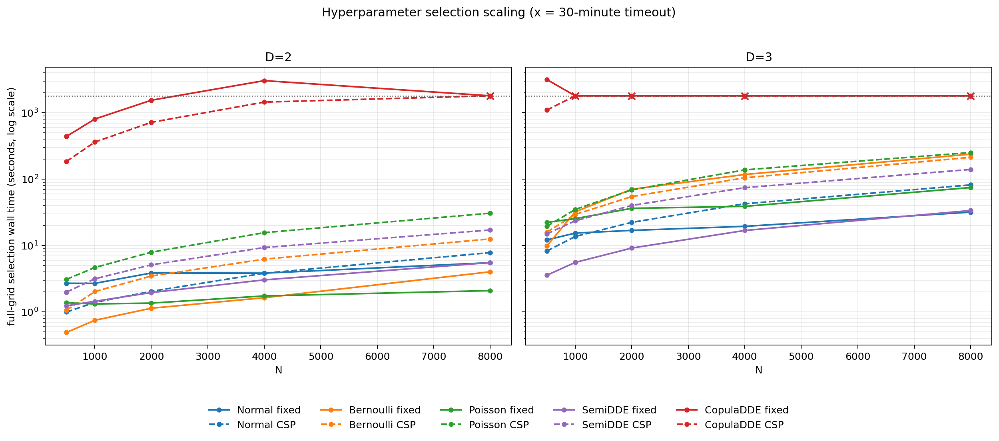

# 全内核超参数选择规模测试

## 结论

- 共覆盖 100 个唯一组合：90 个完整结束，10 个在 30 分钟完整网格上限处超时，0 个代码或数值错误。
- 除 CopulaDDE 外，N=8000、D=3 的所有路径均在本机 4-worker 条件下完成；最慢的是 Poisson CSP（251.6 秒）和 Bernoulli fixed（238.1 秒）。
- CopulaDDE 是明确瓶颈。fixed 在 D=2 可完整运行到 N=4000（50.7 分钟实测），D=3 仅 N=500 完成（52.6 分钟）；CSP 在 D=2 可在 30 分钟内运行到 N=4000（24.1 分钟），D=3 仅 N=500 完成（18.3 分钟）。
- 已完成 CopulaDDE 点中，候选拟合占总时间 98.1%，pMSE 评分只占很小部分；优化重点应放在重复拟合、初始化复用或候选级并行。
- CSP 维度恢复并不均匀：SemiDDE D=2 为 5/5 精确，Poisson D=3 为 4/5；Bernoulli D=2/3 和 Normal D=3 均未精确恢复。预测指标仍较稳定，因此不能用预测拟合质量代替维度恢复检查。

## 测试设置

- N = [500, 1000, 2000, 4000, 8000]，D = 2/3，每个组合 1 个固定随机种子重复。
- 每个任务直接调用当前 `select_hyperparameters()`，所有候选均为笛卡尔积完整 grid search。
- 候选数：普通 fixed 为 D2=12/D3=24，普通 CSP 为 9/27；Copula fixed 为 18/54，Copula CSP 为 9/27。
- 迭代预算：DDE=20；SemiDDE=2 个 outer × 20 个 inner；CopulaDDE=10；优化器 maxiter=30。
- Copula pMSE：2 repeats、3 folds、30 trees。主批次使用 4 个进程并行，每进程 BLAS 单线程；最后的 D=3、N=8000 fixed 点另以单 worker 复核。
- 初始无上限批次保留了两个超过 30 分钟但最终完成的 Copula 点；确认小时级成本后，剩余任务采用 1800 秒可用性上限。timeout 不保留部分网格的最优值。

## 运行时间

### D=2

| 内核 | N=500 | N=1000 | N=2000 | N=4000 | N=8000 |
|---|---:|---:|---:|---:|---:|
| Normal fixed | 2.71s | 2.70s | 3.87s | 3.85s | 5.53s |
| Normal CSP | 1.00s | 1.40s | 2.05s | 3.84s | 7.84s |
| Bernoulli fixed | 0.49s | 0.75s | 1.14s | 1.64s | 4.04s |
| Bernoulli CSP | 1.07s | 2.03s | 3.48s | 6.25s | 12.61s |
| Poisson fixed | 1.38s | 1.32s | 1.36s | 1.75s | 2.10s |
| Poisson CSP | 3.11s | 4.68s | 7.95s | 15.67s | 30.77s |
| SemiDDE fixed | 1.24s | 1.45s | 1.96s | 3.05s | 5.55s |
| SemiDDE CSP | 2.00s | 3.16s | 5.13s | 9.35s | 17.17s |
| CopulaDDE fixed | 7.3m | 13.4m | 25.7m | 50.7m | >30.0m |
| CopulaDDE CSP | 3.1m | 6.0m | 12.0m | 24.1m | >30.0m |

### D=3

| 内核 | N=500 | N=1000 | N=2000 | N=4000 | N=8000 |
|---|---:|---:|---:|---:|---:|
| Normal fixed | 12.19s | 15.44s | 16.95s | 19.49s | 31.91s |
| Normal CSP | 8.30s | 13.71s | 22.38s | 42.63s | 1.4m |
| Bernoulli fixed | 9.92s | 32.25s | 1.2m | 2.0m | 4.0m |
| Bernoulli CSP | 15.97s | 29.41s | 54.71s | 1.7m | 3.6m |
| Poisson fixed | 22.36s | 25.47s | 36.41s | 38.96s | 1.2m |
| Poisson CSP | 19.57s | 35.01s | 1.1m | 2.3m | 4.2m |
| SemiDDE fixed | 3.59s | 5.58s | 9.18s | 16.89s | 33.76s |
| SemiDDE CSP | 15.05s | 23.59s | 40.21s | 1.2m | 2.3m |
| CopulaDDE fixed | 52.6m | >30.0m | >30.0m | >30.0m | >30.0m |
| CopulaDDE CSP | 18.3m | >30.0m | >30.0m | >30.0m | >30.0m |

## CSP 选择出的层宽

标记 ✓ 表示与真值相同；Δ 为层宽 L1 误差。

### D=2

| CSP 内核 | N=500 | N=1000 | N=2000 | N=4000 | N=8000 |
|---|---|---|---|---|---|
| Normal CSP | [10,3] ✓ | [11,4] Δ2 | [10,3] ✓ | [10,3] ✓ | [11,4] Δ2 |
| Bernoulli CSP | [6,0] Δ2 | [6,0] Δ2 | [6,1] Δ1 | [6,0] Δ2 | [6,0] Δ2 |
| Poisson CSP | [6,2] ✓ | [7,2] Δ1 | [6,2] ✓ | [6,2] ✓ | [7,2] Δ1 |
| SemiDDE CSP | [9,3] ✓ | [9,3] ✓ | [9,3] ✓ | [9,3] ✓ | [9,3] ✓ |
| CopulaDDE CSP | [10,4] Δ2 | [9,3] ✓ | [9,4] Δ1 | [9,4] Δ1 | timeout |

### D=3

| CSP 内核 | N=500 | N=1000 | N=2000 | N=4000 | N=8000 |
|---|---|---|---|---|---|
| Normal CSP | [20,8,4] Δ6 | [19,10,4] Δ7 | [20,8,4] Δ6 | [23,11,4] Δ12 | [21,11,2] Δ8 |
| Bernoulli CSP | [16,6,2] Δ2 | [18,5,2] Δ1 | [17,5,2] Δ2 | [16,6,2] Δ2 | [18,5,2] Δ1 |
| Poisson CSP | [18,6,2] ✓ | [18,6,2] ✓ | [18,6,2] ✓ | [19,7,2] Δ2 | [18,6,2] ✓ |
| SemiDDE CSP | [18,6,4] Δ2 | [18,6,4] Δ2 | [18,6,4] Δ2 | [18,7,1] Δ2 | [18,8,1] Δ3 |
| CopulaDDE CSP | [16,6,4] Δ4 | timeout | timeout | timeout | timeout |

## 评估指标

这些指标是在每个生成数据集上对最终选中模型计算；不同分布间不可横向比较。

### Normal: conditional RMSE（越低越好）

| 路径 / D | N=500 | N=1000 | N=2000 | N=4000 | N=8000 |
|---|---:|---:|---:|---:|---:|
| fixed / 2 | 0.9992 | 1.0027 | 1.0003 | 1.0017 | 1.0003 |
| fixed / 3 | 1.0201 | 1.0110 | 1.0045 | 1.0028 | 1.0004 |
| csp / 2 | 1.0045 | 1.0229 | 1.0012 | 1.0056 | 1.0021 |
| csp / 3 | 1.0019 | 1.0030 | 0.9995 | 1.0016 | 1.0021 |

### Bernoulli: conditional log loss（越低越好）

| 路径 / D | N=500 | N=1000 | N=2000 | N=4000 | N=8000 |
|---|---:|---:|---:|---:|---:|
| fixed / 2 | 0.4903 | 0.4936 | 0.4990 | 0.5025 | 0.4998 |
| fixed / 3 | 0.4158 | 0.4221 | 0.4224 | 0.4214 | 0.4291 |
| csp / 2 | 0.4705 | 0.4800 | 0.4796 | 0.4787 | 0.4823 |
| csp / 3 | 0.4279 | 0.4217 | 0.4243 | 0.4281 | 0.4236 |

### Poisson: conditional NLL（越低越好）

| 路径 / D | N=500 | N=1000 | N=2000 | N=4000 | N=8000 |
|---|---:|---:|---:|---:|---:|
| fixed / 2 | 1.0411 | 1.0571 | 1.0651 | 1.0569 | 1.0634 |
| fixed / 3 | 0.9567 | 0.9509 | 0.9258 | 0.9273 | 0.9228 |
| csp / 2 | 1.0430 | 1.0538 | 1.0654 | 1.0573 | 1.0612 |
| csp / 3 | 0.9207 | 0.9133 | 0.8995 | 0.9178 | 0.9132 |

### CopulaDDE: pMSE（越低越好）

| 路径 / D | N=500 | N=1000 | N=2000 | N=4000 | N=8000 |
|---|---:|---:|---:|---:|---:|
| fixed / 2 | 0.0104 | 0.0097 | 0.0093 | 0.0090 | — |
| fixed / 3 | 0.0097 | — | — | — | — |
| csp / 2 | 0.0108 | 0.0102 | 0.0099 | 0.0098 | — |
| csp / 3 | 0.0095 | — | — | — | — |

## CSP 精确恢复汇总

| 内核 | D | 完整结束 | 精确恢复 |
|---|---:|---:|---:|
| Normal CSP | 2 | 5/5 | 3/5 |
| Normal CSP | 3 | 5/5 | 0/5 |
| Bernoulli CSP | 2 | 5/5 | 0/5 |
| Bernoulli CSP | 3 | 5/5 | 0/5 |
| Poisson CSP | 2 | 5/5 | 3/5 |
| Poisson CSP | 3 | 5/5 | 4/5 |
| SemiDDE CSP | 2 | 5/5 | 5/5 |
| SemiDDE CSP | 3 | 5/5 | 0/5 |
| CopulaDDE CSP | 2 | 4/5 | 1/4 |
| CopulaDDE CSP | 3 | 1/5 | 0/1 |

## 数据文件

- `fits.csv`：100 个组合的逐项状态、最优超参、层宽、分数、指标和分项计时。
- `summary.csv`：按内核和 D 聚合的成功数、timeout 数、维度误差、耗时及平均指标。
- `runtime_scaling.png`：对数时间曲线；x 标记表示 30 分钟 timeout。

## 解释限制

- 本轮目标是覆盖所有路径与规模点，因此每格只运行 1 个重复；它能评估接口完整性与运行成本，不能估计恢复率的置信区间。
- 为使 100 格测试可执行，迭代次数低于部分生产默认值；数值指标用于路径间一致性和规模趋势检查。生产收敛研究应在选定 N/D 上增加迭代与重复。
